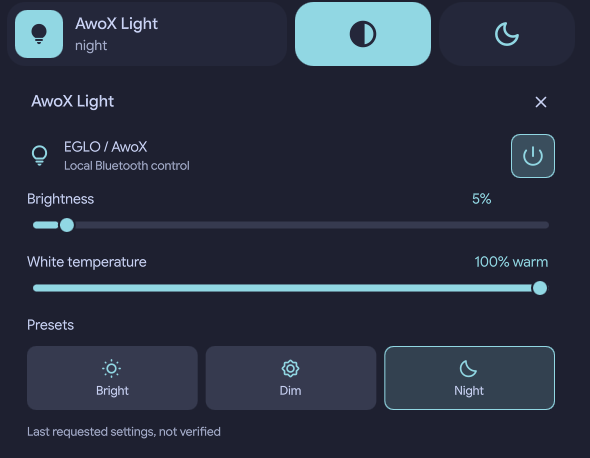

# awox-ble

Control **AwoX / EGLO lights over Bluetooth from Linux**, using a simple command-line tool or the optional [Dank Material Shell (DMS)](https://github.com/AvengeMedia/DankMaterialShell) integration.

No Zigbee coordinator or cloud connection is needed for everyday control.

## Quick start

**Requirements:** Linux with BlueZ, a Bluetooth LE adapter, `git`, [`uv`](https://docs.astral.sh/uv/), systemd user services, and `gatttool` (a legacy BlueZ utility that may need to be installed separately). You also need the Bluetooth mesh credentials for your bulb.

Tested on Arch Linux. Other distributions are not yet verified.

### 1. Install

```bash
git clone https://github.com/lelabdev/awox-ble.git
cd awox-ble
bash scripts/install.sh
```

The installer sets up Python, the `light` command and a systemd user service. It creates a configuration template if you don't already have one. It **does not** change the light during installation.

### 2. Configure your bulb

Edit `~/.config/awox-mesh/config.env` and replace the example values:

```ini
AWOX_MAC=AA:BB:CC:DD:EE:FF
AWOX_MESH_NAME=your_mesh_name
AWOX_MESH_PASSWORD=your_local_mesh_password
AWOX_MESH_ID=0x1234
AWOX_BACKEND=gatt
```

- **MAC address:** find your light with a BLE scanner or `uv run awox-mesh scan`.
- **Mesh ID:** discover it with `uv run awox-mesh discover`; it is different from the MAC address.
- **Mesh name and password:** see the [AwoX mesh credentials tool](https://fsaris.github.io/EspHome-AwoX-BLE-mesh-hub/awoxh-mesh-credentials-tool/). Some bulbs require different **local** credentials from those provided by the cloud; login error `0x0e` can indicate that mismatch.

Keep this file private. The installer sets its permissions to `0600`, and it is not stored in the repository.

### 3. Control the light

```bash
light on              # Switch on
light off             # Switch off
light brightness 50   # Set brightness to 50%
light temperature 80  # Set white warmth to 80% (0 = cool, 100 = warm)

light bright          # 100% brightness, neutral white
light dim             # 25% brightness, warm white
light night           # 5% brightness, warm white
```

For help: `light --help`.

## DMS Control Center



If you use DMS 2.0 or newer, you can install the [Control Center plugin](integrations/dms/awoxLight/) after setting up `light`:

```bash
mkdir -p ~/.config/DankMaterialShell/plugins
ln -s "$PWD/integrations/dms/awoxLight" \
  ~/.config/DankMaterialShell/plugins/awoxLight
```

Enable **AwoX Light** in **DMS Settings → Plugins**, then add its tile using **Control Center → Edit**.

The sliders send a command when released. Values shown in the plugin are **last requested settings**, not live measurements.

## Read the light's status

| Command | What it does |
| --- | --- |
| `light` or `light status` | Quick status; if connected, shows the last requested command (not verified) |
| `light scan` | Releases the BLE connection and waits for repeated status broadcasts (up to 70 seconds) |
| `light service-status` | Shows whether the background service is connected |
| `light release` | Disconnects so the phone app can connect |

**Why can scanning be slow?** The bulb broadcasts complete status data only occasionally. A command being sent successfully doesn't necessarily mean the bulb applied it. `light scan` tries to confirm the reading from repeated Bluetooth broadcasts, but it may time out without a confirmed value.

## Supported hardware

Tested with an **EGLO Filament Zigbee TW** bulb:

| Bluetooth model | Hardware | Firmware |
| --- | --- | --- |
| `ESMLFzm_w6_TW` | `4.63` | `3.0.2_1610` |

Although sold as a Zigbee bulb, this model can also be controlled over Bluetooth. **Other bulbs and firmware versions are not yet confirmed compatible.**

## Troubleshooting

- **`light` command not found:** check that `~/.local/bin` is in your `PATH`.
- **Service unavailable:** run `systemctl --user status awox-ble.service` and inspect logs using `journalctl --user -u awox-ble.service -n 50`.
- **Cannot connect:** check Bluetooth, `gatttool`, your local mesh credentials, and whether AwoX HomeControl on your phone is using the connection.
- **Status not updating:** try `light scan`; complete broadcasts are infrequent.

The service reconnects on demand, then reuses its Bluetooth connection for faster commands. It releases the connection after **120 seconds of inactivity** so the phone app can reconnect. It listens only on a private local Unix socket, not a network port.

## Credits and development

This project builds on [paul-schoettl/awox-mesh](https://github.com/paul-schoettl/awox-mesh). Other useful protocol references are [awoxble2mqtt-api](https://github.com/BastiAKA/awoxble2mqtt-api) and [EspHome-AwoX-BLE-mesh-hub](https://github.com/fsaris/EspHome-AwoX-BLE-mesh-hub).

To run tests:

```bash
uv sync --group dev
uv run pytest -q
uv run ruff check .
```

**License:** MIT.
